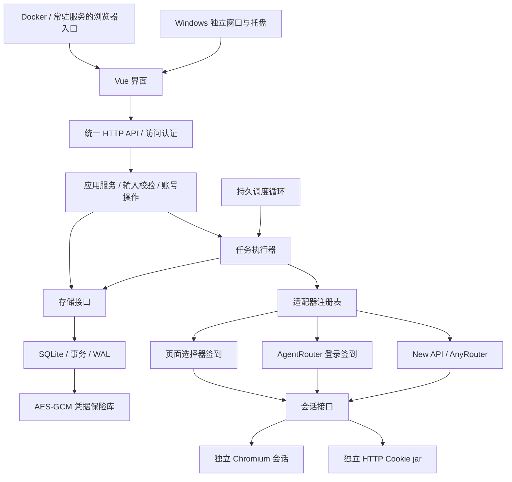
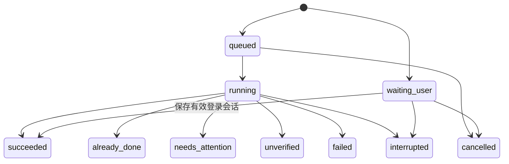

# 项目架构与设计基线

版本：v1，2026-10-15。产品目标：一个可以常驻运行的多站点、多账号自动签到工具，提供简单中文界面，支持 Windows 与 Docker。

## 技术决策

Go 1.27.2 负责 API、调度、SQLite 和站点适配；Vue 3 + TypeScript 负责界面；标准 Chromium 由 chromedp 驱动。Windows 首版采用 Edge/Chrome 独立应用窗口和 Go 原生托盘，Docker 直接提供网页。2026-10-15 已核对官方发布清单：go1.27.2 为最新 stable 版本，已核验下载校验和。go.mod 的 1.27.0 是语言最低版本，实际构建工具链为 1.27.2。

原会话提出 Wails 作为候选；本次本机 WebView2 初始化未能可靠验证，因此最终选择已经通过实际窗口测试的 Chromium 应用窗口，避免再引入一套浏览器运行时。桌面壳可以独立替换，不影响账号、调度或站点适配。测试发现的 WebSocket 连接器缺失已修复，正常运行使用管道，测试端口才显式使用 remote.WebSocket。

采用单进程模块化架构。当前规模无需 Redis、微服务、消息队列或动态执行脚本的插件系统。可扩展性通过接口和配置实现。

## 模块责任与依赖

| 模块 | 责任 | 禁止依赖 |
| --- | --- | --- |
| `internal/domain` | 站点、账号、调度、结果模型与纯校验 | HTTP、SQLite、Chromium、UI |
| `internal/port` | 存储、执行会话、适配器接口 | 具体驱动 |
| `internal/provider` | 适配器注册表、平台协议与结果归一化 | SQL、前端、桌面 API |
| `internal/transport` | 普通 HTTP 会话 | 调度、界面 |
| `internal/browser` | Chromium 资源池、账号隔离上下文、登录、人工操作 | 数据库 |
| `internal/store` | 数据库初始化、事务、持久任务、凭据读写 | 平台适配器、界面 |
| `internal/security` | 密钥、认证辅助、凭据和备份加密 | 业务编排 |
| `internal/app` | 账号操作、调度、执行和人工登录编排 | 前端、Windows API |
| `internal/desktop` | 窗口、托盘、当前用户启动项、桌面偏好 | 平台签到协议、SQL |
| `internal/httpapi` | API 路由、认证、限制、HTTP 错误映射 | 平台私有协议 |
| `internal/bootstrap` | 配置与依赖装配、生命周期 | 页面细节 |
| `cmd/server` / `cmd/desktop` | 服务与桌面入口 | 重复的业务逻辑 |
| `web/src` | 视图、表单、状态反馈、API 客户端 | 平台 Cookie 读回、直接调用目标站点 |

依赖沿“入口 → 应用 → 领域/接口”流动。数据库、浏览器、HTTP 为接口实现，由 bootstrap 注入。避免让每个适配器实现不需要的密钥/渠道管理方法。

## 数据模型

- **Site**：具体站点地址、模板标识、适配器类型、执行方式、接口路径、额度单位、可选页面选择器。模板名称和默认配置集中在领域目录，保存 `template_id` 后可修改镜像地址而不丢失模板身份；运行时仍按适配器执行。
- **Account**：站点引用、名称、开关、调度参数、配置版本号、运行状态。凭据与公开信息分离。
- **Credentials**：登录方式、用户名密码、Cookie、用户 ID、可选令牌、浏览器 Cookie/localStorage。以账号 ID 为关联数据使用 AES-256-GCM 加密；列表接口只返回“是否已配置”。
- **Run**：一次排队/执行/人工登录，保存账号和站点名称快照、触发来源、状态、时间、尝试次数及归一化结果。不保存原始响应正文或请求头。
- **Settings**：调度开关、总并发、最大重试次数、首次重试间隔、任务超时、同站点最小间隔、历史保留天数。

站点有账号引用时禁止修改 origin / 适配器 / 模板，避免已有凭据被发往新地址。有 OAuth 账号时禁止切换到 HTTP，账号保存也在事务内复核站点执行方式。编辑配置使用版本号校验，正在执行或人工登录的账号拒绝编辑和删除。新增账号不读取用户现有浏览器。

## 执行与结果

- `succeeded`：有站点业务响应或明确页面结果作为证据，金额可以未知。
- `already_done`：站点明确表示已签到，或者 AgentRouter 明确返回 `checked_in=false`。
- `unverified`：请求可能生效，但缺少可验证结果；暂停自动执行，等待人工确认。
- `needs_attention`：登录失效、验证挑战、缺少登录方式等；暂停自动执行。
- `failed`：明确失败。网络请求尚未发出时的连接故障、HTTP 429 / 5xx 等临时故障允许有限重试；明确业务拒绝不自动重试。用户仍可逐个账号选择手动重试。
- `interrupted`：上次进程在操作期间退出，结果未知；不会伪造成功或直接重放可能已生效的请求。

登录动作和签到动作在记录里区分，登录成功不会增加签到成功计数。余额前后快照是观察值，只有 `quota_awarded` 等明确字段才计为奖励。

## 调度和并发

1. 所有账号默认北京时间 08:00–09:00 随机首次执行，目标是每天成功一次。以账号 ID 与北京时间日期确定随机秒，账号之间分别安排，重启不会重新抽取。
2. 部分唯一索引确保每个账号最多一个活跃任务。任务事务领取，不依赖“按钮已禁用”防重复。
3. 固定数量 worker 控制总并发；同 origin 执行串行并保持最小间隔。手动与定时共用入口。
4. 数据库保存 `next_run_at` 与每次任务开始时间。成功/已签到后当天停止；失败重试默认最多 2 次（总计 3 次尝试），延迟约 5 / 15 分钟并增加 0–30 秒随机扰动。429 的 Retry-After 取更长者。重启不会清空次数，也不重新计算已保存的重试时间。
5. 首次窗口内启动可补跑当日已经到点的任务；失败补签允许到 09:00。超出相应窗口或耗尽重试预算后排入次日，不重放过去多天的任务。只有明确临时失败会进入补签队列；凭据错误、验证码和未知结果暂停。手动操作可在窗口外发起，第二次操作须明确选择单账号“手动重试”；已确认完成的账号当天仍禁止再次执行。
6. 自动任务的上下文截止时间取任务超时与窗口结束时间的较早者，响应丢失后的状态复核继承此截止时间；不会通过脱离上下文延长站点访问。
7. 保存登录、取消登录或执行结束后关闭账号上下文及其弹窗，空闲池只保留空白进程。程序关闭时取消上下文、等待 worker、关闭浏览器、完成记录、关闭数据库。独占数据目录防止桌面和服务重复启动。

空闲 worker 阻塞等待广播通知；调度器使用索引查找没有活跃任务的最近计划，以单次定时器等待到期，最多每小时醒来清理历史并校准计划。新增/修改/删除账号、设置变更、恢复备份、任务结束和人工登录结束均通知调度器。先订阅通知再读取数据库，避免修改发生在扫描和休眠之间时丢失唤醒；调度器与 worker 使用独立广播，入队不会反复唤醒自身。数据库故障时采用有限频率的恢复查询。领取任务从仅含排队任务的索引开始，按账号和开始时间索引统计每日尝试，避免扫描已结束的历史。过期队列项在同次领取中取消并继续查找；重试预算变更后不再允许的到期任务会顺延，避免反复扫描。

调度不是远端业务的 exactly-once 保证。发生“远端生效、本地未记账”的崩溃窗口时，必须保留未知状态并交给用户或平台状态接口确认。

## 浏览器会话与人工处理

后台复用一个惰性启动的 Chromium 进程，最多两个独立 BrowserContext。Cookie 查询显式指定当前 BrowserContext，localStorage 按账号和允许的 origin 恢复，禁止读回其他账号的 Cookie。关闭会话销毁其上下文；全部空闲 60 秒后关闭浏览器进程并清理临时 profile。浏览器异常退出后下次操作重新启动，单个上下文关闭不影响另一个账号。

可见窗口和后台进程共用进程创建与清理实现。启动、退出和目录清理在资源池锁外完成；并发启动通过通知等待，等待中的账号可独立取消。恢复的 localStorage 仅在首个页面注入一次，随后移除恢复脚本，避免覆盖新登录状态或撤销站点退出操作。已关闭标签页会从跟踪顺序中移除。

普通请求通过浏览器同源 fetch 完成，不使用跨站请求代理。密码登录按可配置 CSS 选择器输入；OAuth 通过站点实际登录按钮发起，不从 HTML 任意提取 code、不切换到未配置的备用域名。

网页签到的选择器可留空。自动模式匹配可见、可操作且文字/无障碍标签明确的签到控件，排除登录、隐藏、禁用和跨站链接；多个候选时拒绝点击。结果只认可明确签到提示或配置的标识，不根据普通“成功”文本猜测。检查与点击在同一段脚本中重新核验，响应丢失不重复点击。识别脚本独立嵌入程序，运行时不下载脚本、不请求模型服务。普通接口会话检查遇到网络错误、429/5xx、验证页面或身份不符时不会重新提交密码；只在明确认证过期时续期。状态查询禁用缓存，兼容 New API 的 `stats.checked_in_today` 和 WONG 的 `data.checked_in`。

Windows 桌面人工登录使用临时配置目录中的独立可见浏览器窗口，直接处理键盘、滚动、授权和验证码；管理界面只提供显示窗口、保存及取消，不进行截图轮询。完成、取消、关闭浏览器或十分钟过期后释放窗口与临时目录。它与后台任务共用总计两个会话的容量限制，达到上限立即返回繁忙。

Docker / 网页管理使用受鉴权保护的 JPEG 预览，可直接键入、粘贴，也保留文字输入栏。操作后立即刷新，交互期间短时加快刷新，空闲降低频率，隐藏界面停止采集；连续滚轮事件合并。截图最多等待两秒，输入最多五秒，保存验证最多十二秒。截图和输入分别执行；取消先中断浏览器操作，再清理会话，避免等待慢页面时所有按钮一同失去响应。

尚未发送的相邻文字合并为一次输入，按键和点击保持顺序边界。网页隐藏时中止正在读取的截图，并停止截图定时器；会话结束或过期后停止刷新。客户端超时覆盖完整响应体。启动人工登录时先锁定账号，再读取凭据；启动请求断开时取消浏览器，启动成功后会话独立于原 HTTP 请求存活。

浏览器驱动单独跟踪同一账号上下文中的新标签页，支持 OAuth 同页跳转、新窗口及关闭后的返回。共享进程中的其他账号页面不会被接管；可见窗口使用独立进程和配置目录。API 请求及 localStorage 读取选择配置站点所在页面，Cookie 始终从所属账号的浏览器上下文读取。

API 全部需要管理访问令牌。API 类站点保存前验证用户信息，通用页面流程保存受限域的会话并在实际签到时核验结果。Docker 无需开放 CDP 或另装 VNC。

## Windows 桌面与资源管理

WindowsIntegration 通过 `port.DesktopIntegration` 注入 HTTP 入口，Docker/服务版不加载 Windows API。托盘使用串行命令队列管理八个菜单项，桌面偏好采用版本校验和文件原子替换。自启动只写当前用户的 Run 项，启动参数为后台驻留和当前数据目录；偏好写入失败时回滚本次启动项变更。

最小化到托盘和关闭后继续运行默认开启，自启动默认关闭。收起窗口释放显示浏览器进程，后台调度保留，恢复窗口重新连接同一 Go 服务。窗口检测的 Windows 回调只分配一次，避免长期运行耗尽系统回调槽位。重复启动会尝试激活原有实例。

界面可见时空闲每 30 秒、任务进行中每 5 秒轻量刷新账号与设置，请求完成后再安排下一次刷新；隐藏界面停止轮询，重新显示时立即刷新。服务端快照使用浅层响应状态，表单维护自己的副本，减少大列表的嵌套代理与序列化复制。历史记录仅在记录页面读取，筛选和分页变化合并成一次读取，筛选变更和页面离开会中止旧查询；同一查询未完成时的刷新合并成一次后续读取，打开的详情随查询结果更新。账号列表通过唯一活跃任务索引关联一次取得任务 ID 与状态。后台浏览器只在需要时启动。诊断接口报告 Go 堆和资源池状态，不把 Go 堆误当作进程总内存。

保存操作触发的完整刷新会等待旧请求结束后执行，多次请求合并；退出管理界面时取消读取并清空状态，迟到响应不能重新显示旧账号。站点账号数按列表变化一次统计，最近计划通过单次遍历查找，避免每次渲染重复扫描或排序。

## 安全与维护约束

- 默认监听 loopback；Docker 暴露界面仍必须使用访问令牌。浏览器入口从 URL fragment 获取首次令牌并立即移除，API 只接受 Authorization 头。
- TLS 验证保持启用；明文 HTTP 仅由显式部署选项开启。接口路径必须相对同一 origin；HTTP 重定向禁止把凭据带到其他 origin。
- 本地密钥独立于数据库，默认同处可执行文件旁的 `data`；Windows 文件 ACL 继承部署目录。目录不可写时明确失败，密钥丢失无法恢复原数据库的凭据。
- 全新安装只初始化指定的数据目录，不导入旧缓存目录；桌面偏好在存储初始化完成后加载。
- 加密备份使用独立口令派生密钥，可迁移至新数据目录；备份和恢复均检查版本、大小与完整性。
- 输入大小、JSON 字段、时间范围、路径和选择器长度均有边界。日志不记录密码、Cookie、Token、OAuth code 或页面正文。
- 数据库只支持新建和同版本重开，不兼容旧版本。SQLite 的外键约束、等待超时和 WAL 设置随每个连接初始化，取消请求导致连接重建时也保持有效。站点关联账号、待执行队列和每日尝试计数均有专用索引。配置与运行状态更新分离；通过契约测试固定适配器语义。

## 明确的产品边界

本版面向单人自托管，不包含团队权限、多实例调度、手机原生应用、API 密钥管理、自动注册、自动破解验证码和收益保证。自动更新、多节点队列属于后续独立扩展。人工登录属于用户主动维护凭据的操作，不代表自动签到成功。

验收证据与未完成的外部验证见 [进度与验收](progress.md)。
